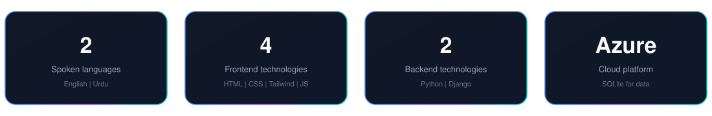

  
   
  

  **Frontend Developer** learning full stack development

  
  

 

  

---

  

I am a frontend developer currently learning **full stack development** at an internationally recognised institute. I am focused on understanding how real-world applications are designed and built — from the interface through to the server and data layer.

- Building interfaces with HTML, CSS, Tailwind CSS, and JavaScript
- Expanding into Python, Django, SQLite, and Azure
- Practising design and collaboration with Figma and Slack

---

  

### Frontend Mentor interfaces
I have developed several frontend interfaces from challenges on [Frontend Mentor](https://www.frontendmentor.io/). These projects practise layout, styling, and turning a design into a working page using HTML, CSS, Tailwind CSS, and JavaScript.

---

  

**Frontend**

**Backend**

**Cloud & DevOps**

**Databases**

**Tools**

---

  

| Area | Skills |
| :--- | :--- |
| Frontend | HTML, CSS, Tailwind CSS, JavaScript |
| Backend | Python, Django |
| Cloud & data | Azure, SQLite |
| Design & collaboration | Figma, Slack |
| Languages | English, Urdu |

---

  

  
  

---

  

  [GitHub](https://github.com/hafsapixie) · [Email](mailto:hafsan1608@gmail.com)

  

  Thanks for visiting.

